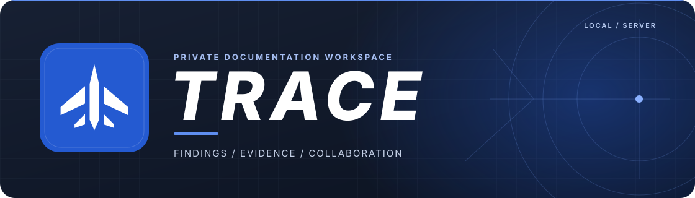

<p align="center">
  
</p>

TRACE is an open-source, self-hosted penetration testing documentation application. Run it locally or on your own server with Python 3.13, Django 5.2 LTS and SQLite, with optional PostgreSQL support.

<p align="center">
  
  
  
  
</p>

## Features

- Engagements with scoped team roles, lifecycle management, notes and milestones.
- Asset inventory and structured test cases with assignments, workflows and reusable templates.
- Findings with independent review, related assets/tests and shared templates.
- Private evidence uploads, authorized downloads and integrity verification.
- Versioned reports in editable DOCX, PDF and self-contained HTML.
- Audit history, concurrent-edit conflict review and local assets for offline use.

## Quick start

Use **Python 3.13** on Linux or macOS; on Windows, use **WSL2**. Install the [PDF system dependencies](docs/reports.md#offline-pdf-dependencies) first. Keep the project and its private storage on local disk outside network or synchronized folders.

From the repository root:

```sh
python3.13 -m venv .venv
source .venv/bin/activate
python -m pip install -r requirements/test.txt
python manage.py migrate --noinput
python manage.py configure_sqlite
python manage.py createsuperuser
python scripts/serve.py --development
```

Open <http://127.0.0.1:8000/> and sign in with the administrator you created. There are no default credentials.

Create standard accounts through **Users → Create user**, then open **Engagements → New engagement** and assign an active Lead. New accounts gain engagement access through team membership.

These commands use development settings. Environment files are not loaded automatically; [.env.example](.env.example) lists the available variables. See the [installation guide](docs/installation.md) for platform-specific setup, offline installation and server hosting.

## Demo data

After migrations and administrator setup, load fictional training engagements:

```sh
python manage.py seed_demo --admin ADMIN_USERNAME --settings=config.settings.development
```

Sign in with your existing administrator account. Demo role accounts have unusable passwords. Reruns preserve existing exercises and edits; see the [demo data guide](docs/demo-data.md) for contents and recovery details.

## Documentation

### Installation and operations

- [Installation](docs/installation.md) — Linux, macOS, WSL2, offline packages and optional Compose.
- [Operations](docs/operations.md) — backups, recovery, maintenance and health checks.
- [Upgrades](docs/upgrading.md) — update and rollback procedures.
- [PostgreSQL](docs/postgresql.md) — optional database configuration and transfer.
- [Storage controls](docs/storage-controls.md) — evidence quotas and reconciliation.

### User workflows

- [Engagements](docs/engagements.md) — roles, lifecycle, notes, milestones and team access.
- [Assets and test cases](docs/assets-and-testcases.md) — inventory, assignments and templates.
- [Findings](docs/findings.md) — documentation and review.
- [Evidence](docs/evidence.md) — private uploads, downloads and cleanup.
- [Reports](docs/reports.md) — generation, formats and template customization.
- [Concurrent editing](docs/concurrent-editing.md) — conflicts and manual merging.
- [Audit and revision history](docs/audit-history.md) — history, verification and retention.
- [UI conventions](docs/ui-conventions.md) — navigation, search, themes and forms.

### Development and security

- [Architecture](docs/architecture.md) — application structure and security design.
- [Project conventions](AGENTS.md) — contribution and verification rules.
- [Security](SECURITY.md) — limitations and vulnerability reporting.
- [Samples](samples/README.md) — synthetic training material.

## Development checks

With the development environment active, run:

```sh
python manage.py migrate --noinput
python manage.py makemigrations --check --dry-run
python manage.py check
python -m pytest
python scripts/vendor_assets.py --check
```

Tests isolate storage in a temporary directory and use file-backed SQLite. Optional lint, type and security tools are listed in `requirements/quality.txt`.

## License

[MIT](LICENSE).
